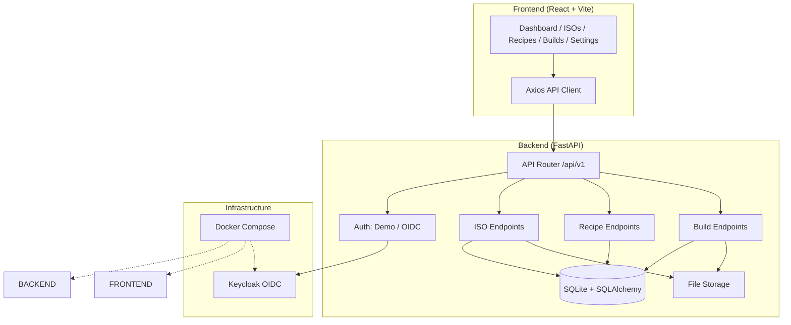

# beacon-engine | Alan Vo | AI & Machine Learning

> Work in progress. This checkpoint may be incomplete or fail tests. See PLAN.md and STATUS.md before use.


A web-based tool for building smaller, customized Windows 11 images. Upload a Windows ISO, create build recipes with component removals, registry tweaks, and unattend settings, then orchestrate builds with real-time progress tracking.

## Problem & Approach

Building custom Windows images manually with DISM is error-prone and requires deep Windows servicing knowledge. beacon-engine provides a structured workflow: upload an ISO → define a recipe (components to keep/remove, registry changes, unattend.xml snippets) → start a build job that executes stages (mount, inventory, component cleanup, registry tweaks, unmount, ISO creation) with progress tracking and logs.

**Implemented AI/ML approach**: The recipe builder uses deterministic schema validation (no LLM required). An optional LLM integration can assist with recipe generation and analysis when configured, but all core functionality works offline.

**Intended user**: Windows enthusiasts, IT administrators, and developers who need reproducible, minimal Windows 11 images for testing, deployment, or specialized environments.

## Features

- **ISO Management**: Upload Windows ISOs with automatic SHA256 deduplication and metadata extraction (version, edition, build, architecture)
- **Recipe Builder**: Create versioned build recipes with components, removals, registry tweaks, and unattend snippets; JSON schema validation; clone existing recipes
- **Build Orchestration**: Start builds linking ISO + recipe; track stages (pending → mounting → inventory → component_cleanup → registry_tweaks → unmounting → iso_creation → completed/failed); real-time progress via polling; persistent logs
- **Authentication**: Demo mode for local development; OIDC/Keycloak integration for production with role-based access (viewer, operator, admin)
- **Responsive UI**: React + TypeScript + Vite frontend with dark theme, loading/error/empty states, and full keyboard navigation

## Quick Start

### Prerequisites
- Docker 24+ and Docker Compose v2
- Or: Python 3.12, Node.js 24, SQLite

### Docker (Recommended)

```bash
# Clone and navigate
cd beacon-engine-alan-vo

# Copy environment template
cp .env.example .env

# Start services (backend, frontend, optional Keycloak)
docker compose up -d

# Access frontend at http://localhost:5173
# Backend API at http://localhost:8000/api/v1
# API docs at http://localhost:8000/docs
```

### Local Development

```bash
# Backend
cd backend
python -m venv .venv
source .venv/bin/activate
pip install -r requirements.txt
uvicorn app.main:app --reload --host 127.0.0.1 --port 8000

# Frontend (separate terminal)
cd frontend
npm install
npm run dev

# Run tests
cd backend && .venv/bin/pytest
cd frontend && npm test
```

## Architecture



## API Endpoints

| Method | Endpoint | Description |
|--------|----------|-------------|
| GET | `/api/v1/healthz` | Health check |
| GET | `/api/v1/users/me` | Current user info |
| PATCH | `/api/v1/users/me` | Update current user |
| POST | `/api/v1/isos` | Upload ISO |
| GET | `/api/v1/isos` | List ISOs (paginated) |
| GET | `/api/v1/isos/{id}` | Get ISO details |
| DELETE | `/api/v1/isos/{id}` | Delete ISO |
| POST | `/api/v1/recipes` | Create recipe |
| GET | `/api/v1/recipes` | List recipes (paginated) |
| GET | `/api/v1/recipes/{id}` | Get recipe |
| PATCH | `/api/v1/recipes/{id}` | Update recipe |
| DELETE | `/api/v1/recipes/{id}` | Delete recipe |
| POST | `/api/v1/recipes/{id}/clone` | Clone recipe |
| POST | `/api/v1/builds` | Start build |
| GET | `/api/v1/builds` | List builds (paginated, filterable) |
| GET | `/api/v1/builds/{id}` | Get build details |
| GET | `/api/v1/builds/{id}/logs` | Get build logs |
| DELETE | `/api/v1/builds/{id}` | Delete build |

## Security Limitations

- **Demo mode** binds to localhost only and uses a hardcoded user — never use in production
- **No HTTPS** in development — deploy behind a TLS reverse proxy (Traefik, Nginx, Caddy)
- **SQLite** is single-writer — not suitable for high-concurrency production use
- **File storage** is local filesystem — use object storage (S3, MinIO) for production
- **No rate limiting** — add at reverse proxy layer
- **Keycloak** uses dev-file DB — configure PostgreSQL for production

## Provider Configuration

| Variable | Description | Required |
|----------|-------------|----------|
| `LLM_API_KEY` | API key for LLM provider | No (opt-in) |
| `LLM_PROVIDER` | `openai-compatible`, `anthropic`, `gemini`, `ollama` | No |
| `LLM_MODEL` | Model identifier | No |
| `LLM_BASE_URL` | Custom endpoint (LiteLLM, Ollama, OpenRouter) | No |

LLM integration is advisory only — all core build operations are deterministic and work without any LLM key.

## SSO/SAML Setup

Keycloak supports SAML identity providers through identity brokering:

1. Enable `with-auth` profile: `docker compose --profile with-auth up -d`
2. Access Keycloak at `http://localhost:8080` (admin/admin)
3. Create realm `beacon-engine`
4. Configure SAML Identity Provider under **Identity Providers → SAML v2.0**
5. Map SAML attributes to Keycloak roles (viewer, operator, admin)
6. Set `DEMO_MODE=false` and configure OIDC variables in `.env`

## Backup & Restore

```bash
# Backup database and uploads
docker compose exec backend tar czf /backup/beacon-$(date +%F).tar.gz /app/data

# Restore
docker compose exec backend tar xzf /backup/beacon-<date>.tar.gz -C /
```

## AI/ML Evaluation

This project's AI/ML component is the optional LLM-assisted recipe generation. The core product is deterministic.

**Reproducible baseline**: Run the test suite to verify recipe schema validation and build orchestration logic.

```bash
cd backend && .venv/bin/pytest -v
cd frontend && npm test
```

**Failure cases**: LLM responses are never fabricated — provider errors are surfaced to the user with clear messages. The system degrades gracefully when LLM is unavailable.

## License

MIT License — Copyright © 2026 Alan Vo <alanvo@gmail.com>

---

*beacon-engine — Alan Vo | AI & Machine Learning — alanvo@gmail.com*